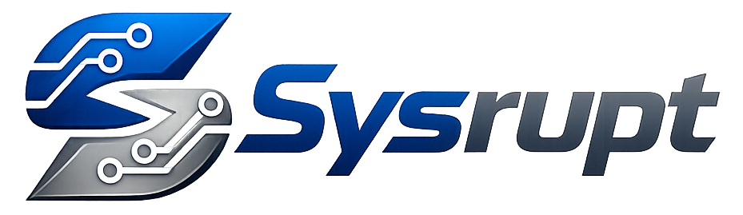
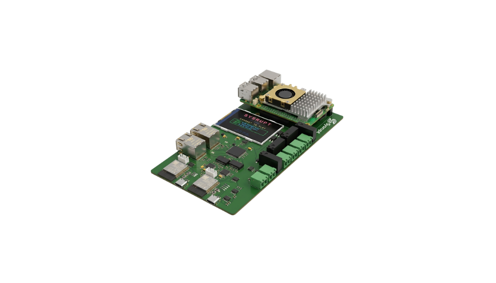
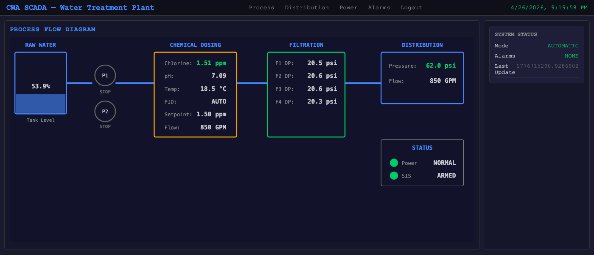
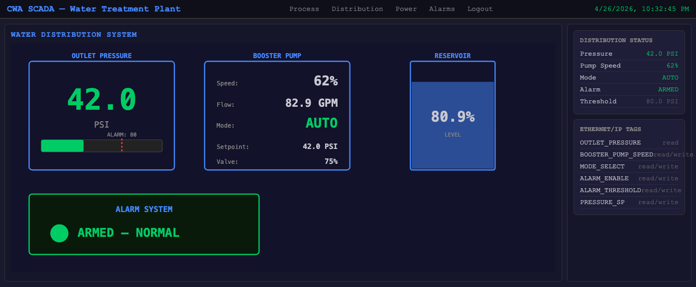
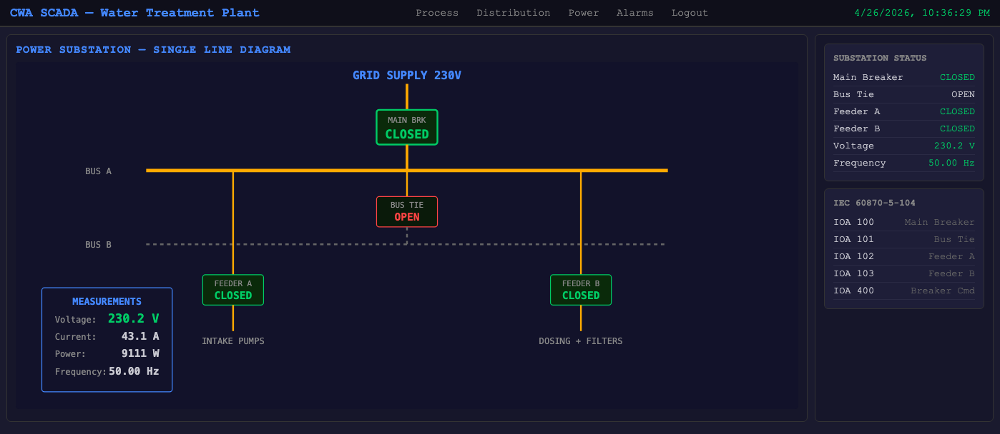
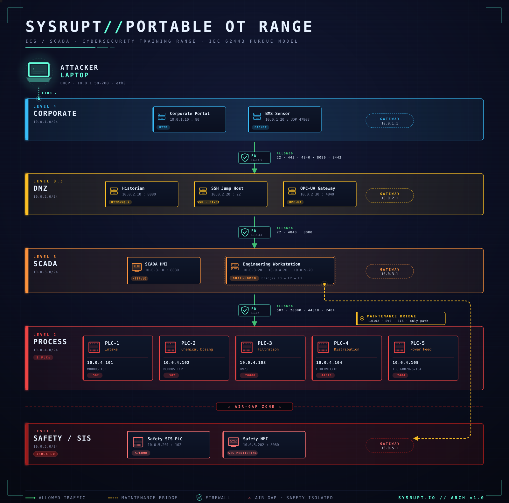

<div align="center">



### Hack a water treatment plant from a board that fits in your backpack.

A self-contained ICS/SCADA cyber range: 5 Purdue zones, 8 real industrial protocols, 10 progressive challenges, and a live HMI where every attack has visible physical impact.

[](https://github.com/s34s0n/sysrupt-portable-ot-range/releases/tag/v1.0.0)
[](LICENSE)
[](https://github.com/s34s0n/sysrupt-portable-ot-range/stargazers)

[](#-talks--demos)
[](#-talks--demos)
[](#-architecture)
[](#-under-the-hood)

[**Quick Start**](#-quick-start) · [**Challenges**](#-challenges) · [**Architecture**](#-architecture) · [**Hardware**](#-hardware) · [**Download Image**](https://github.com/s34s0n/sysrupt-portable-ot-range/releases/tag/v1.0.0)

<br>



</div>

<br>

<div align="center">

| 🏭 **5** Network Zones | 🔌 **8** ICS Protocols | 🚩 **10** Challenges | ⚙️ **20** Services | ⏱️ **90s** Boot | ☁️ **0** Cloud |
|:---:|:---:|:---:|:---:|:---:|:---:|

</div>

## ⚡ Why Sysrupt

> **Plug in an Ethernet cable. Hack a water treatment plant. Learn ICS/SCADA security.**

Most OT training needs racks of PLCs, a lab you can't move, or a cloud VM that feels nothing like a plant floor. Sysrupt puts a full water treatment facility, power substation, and safety system on a single custom PCB.

- **Real protocols, not mocks.** Modbus, DNP3, IEC 104, S7comm, EtherNet/IP, BACnet, OPC-UA, each as a dedicated service.
- **Physical consequences.** A physics engine drives chlorine, tank levels, and grid state. Break something and the HMI shows it.
- **No flag pasting.** Exploits are auto-detected and the on-board scoreboard updates itself.
- **Runs anywhere.** Conferences, red team training, university labs, workshops. Air-gapped by design.

## 🖥️ Live SCADA HMI

Every attack lands on the operator's screen in real time. Mess with the dosing pump and chlorine climbs. Trip the substation breaker and the single-line diagram goes red.

<table>
<tr>
<td width="33%"></td>
<td width="33%"></td>
<td width="33%"></td>
</tr>
<tr>
<td align="center"><b>Process Overview</b><br><sub>Tank levels, dosing, filtration, distribution</sub></td>
<td align="center"><b>Water Distribution</b><br><sub>Pressure, booster pump, reservoir, EtherNet/IP tags</sub></td>
<td align="center"><b>Power Substation</b><br><sub>Single-line diagram, breakers, IEC 104 tags</sub></td>
</tr>
</table>

## 🏗️ Architecture

Five zones modelled on the **IEC 62443 Purdue Reference Model**. Students land in Corporate and have to pivot all the way down to Safety.

<div align="center">

</div>

| Level | Zone | Subnet | What's Inside |
|:---:|---|---|---|
| L4 | 🏢 **Corporate** | `10.0.1.0/24` | Web portal, building management system |
| L3.5 | 🛡️ **DMZ** | `10.0.2.0/24` | Historian, OPC-UA gateway, SSH jump host |
| L2 | 📊 **SCADA** | `10.0.3.0/24` | HMI with live process visualisation, engineering workstation |
| L1 | ⚙️ **Process** | `10.0.4.0/24` | 5 PLCs speaking Modbus, DNP3, EtherNet/IP, IEC 104 |
| L0/SIS | 🚨 **Safety** | `10.0.5.0/24` | Safety Instrumented System (air-gapped... or is it?) |

## 🔌 Protocols

| Protocol | Port | Real-World Use |
|---|---|---|
| **HTTP** | `80` | Corporate systems, SCADA web interfaces |
| **OPC-UA** | `4840` | Industrial data exchange (Industry 4.0) |
| **BACnet/IP** | `47808/udp` | HVAC, lighting, access control |
| **DNP3** | `20000` | Power grids, water utilities |
| **EtherNet/IP** | `44818` | Rockwell / Allen-Bradley factory automation |
| **IEC 60870-5-104** | `2404` | European power grid SCADA |
| **Modbus TCP** | `502` | PLCs, RTUs, chemical dosing |
| **S7comm** | `102` | Siemens safety controllers |

## 🚩 Challenges

Ten challenges, **4,700 points**, one continuous kill chain from the internet-facing portal to the safety controller.


| # | Challenge | Pts | What You'll Do | Hints |
|:---:|---|:---:|---|:---:|
| 01 | **Perimeter Breach** | 100 | Scan, exploit web vulns, gain initial access | [📖](docs/challenges/ch01.md) |
| 02 | **Intelligence Gathering** | 200 | Browse OPC-UA, extract plant credentials | [📖](docs/challenges/ch02.md) |
| 03 | **Pivot to OT** | 300 | SQL injection, SSH tunnelling across zones | [📖](docs/challenges/ch03.md) |
| 04 | **Building Recon** | 350 | Discover hidden UDP services, explore BACnet | [📖](docs/challenges/ch04.md) |
| 05 | **Deep Protocol: DNP3** | 400 | Decode protocol data, solve a CRC challenge | [📖](docs/challenges/ch05.md) |
| 06 | **Silent Overpressure** | 450 | Disable alarms, cause damage undetected | [📖](docs/challenges/ch06.md) |
| 07 | **Power Blackout** | 500 | Trip a substation breaker, watch the HMI go dark | [📖](docs/challenges/ch07.md) |
| 08 | **Process Manipulation** | 600 | Override the PID controller, manipulate dosing | [📖](docs/challenges/ch08.md) |
| 09 | **Safety Assault** | 800 | Find a hidden bridge, bypass the safety system | [📖](docs/challenges/ch09.md) |
| 10 | **Full Compromise** | 1000 | Chain everything, push chlorine to lethal levels | [📖](docs/challenges/ch10.md) |

> 🎯 **Auto-detected scoring.** No manual flag submission. Hack the system and the 320×240 on-board display updates with progress, hints, and retro arcade celebrations.

## 🌍 Real-World Relevance

The attack chain mirrors techniques from incidents that defined OT security:

| Incident | Year | Reproduced Here |
|---|:---:|---|
| **Stuxnet** | 2010 | PLC manipulation + safety system bypass |
| **Ukraine Power Grid** | 2015 | IEC 104 breaker trip commands |
| **TRITON / TRISIS** | 2017 | Safety Instrumented System compromise |
| **Oldsmar Water Plant** | 2021 | Remote chemical dosing manipulation |

## 🚀 Quick Start

**You need:** a Kali laptop (or any Linux with Python 3), an Ethernet cable, and a Sysrupt board.

**1. Operator (one-time, on the board)**

Flash the pre-built SD image from the [**v1.0.0 release**](https://github.com/s34s0n/sysrupt-portable-ot-range/releases/tag/v1.0.0), insert, power up, plug in Ethernet. Done. Building from source? See [INSTALL.md](INSTALL.md).

**2. Student (on the attacker laptop)**

```bash
cd kali-setup && sudo bash kali-setup.sh   # install tools
# plug Ethernet into the Sysrupt board, DHCP drops you in Corporate
nmap -sT 10.0.1.0/24                        # start hacking
```

> [!WARNING]
> Default operator credentials (`sysrupt` / `sysrupt21`) and in-scenario credentials (`maintenance` / `maint2024!`, `engineer` / `eng2024!`) are documented in the student guide. **Change the `sysrupt` password immediately** if the board is ever exposed outside the lab.

<details>
<summary><b>🧰 Bundled protocol explorers</b></summary>

<br>

```bash
python3 ~/tools/bacnet-tool.py -h   # BACnet/IP
python3 ~/tools/dnp3-tool.py   -h   # DNP3
python3 ~/tools/enip-tool.py   -h   # EtherNet/IP
python3 ~/tools/iec104-tool.py -h   # IEC 60870-5-104
python3 ~/tools/modbus-tool.py -h   # Modbus TCP
python3 ~/tools/s7comm-tool.py -h   # S7comm (Siemens)
```

</details>

## 🔧 Under the Hood

Everything runs on one appliance:

| Component | Detail |
|---|---|
| **Isolation** | 16 Linux network namespaces, 5 bridges, iptables zone firewalls |
| **Services** | 20 background services: PLCs, web apps, SSH, IDS, physics engine |
| **Physics engine** | Simulates chlorine dosing, tank levels, and the power grid |
| **HMI** | Live gauges for pressure, chlorine, breaker states |
| **CTF engine** | Watches Redis for exploit conditions and scores automatically |

## 🔩 Hardware

A purpose-built ICS training appliance on a **4-layer custom PCB** designed in Altium Designer.

- Sysrupt compute core running a hardened Linux build
- ILI9341 320×240 SPI scoreboard display
- USB-C PD power delivery
- Status LEDs and expansion headers

Fully open design files in [`hardware/`](hardware/):

| Directory | Contents |
|---|---|
| [`Source/`](hardware/Source) | Altium schematic (`.SchDoc`) and PCB layout (`.PcbDoc`) |
| [`Gerber/`](hardware/Gerber) | Manufacturing files, ready for fab |
| [`BOM/`](hardware/BOM) | Bill of materials |
| [`3D/`](hardware/3D) | STEP model for mechanical integration |

<details>
<summary><b>🗺️ Roadmap: v1.0 → v1.1</b></summary>

<br>

The on-board **RTL8367S managed switch** and **dual ESP32-C6 modules** (for hardware-backed PLC and IIoT simulation) are populated on v1.0 but not yet driven by firmware. v1.0 ships with a software-emulated switch (bridges + namespaces) and software PLCs/IIoT. Native switch configuration and ESP32-C6 firmware land in **v1.1**.

</details>

## 🎤 Talks & Demos

| Event | Year | Track |
|---|:---:|---|
| **Black Hat Asia**: Arsenal Lab | 2026 | Hardware workshop |
| **DEF CON Singapore**: Demo Labs | 2026 | Tool demo |

Slides and recordings will be linked here once published. The SD image used at both events is in the [v1.0.0 release](https://github.com/s34s0n/sysrupt-portable-ot-range/releases/tag/v1.0.0).

## 📜 License

MIT. See [LICENSE](LICENSE).

## 🙏 Acknowledgements

Portions of the codebase were co-authored with Anthropic's Claude.

<div align="center">
<br>
<sub>Built by <a href="https://github.com/s34s0n">@s34s0n</a> · If Sysrupt helped you learn or teach OT security, drop a ⭐</sub>
</div>
